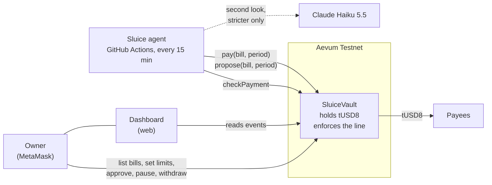

# Sluice

**An AI agent that pays your company's bills, but can't spend past the line you set.**

Small and mid-size companies have no treasury team. Bills are paid by hand, cash runs short without warning, and fake "we changed our bank details" invoices took about $3 billion from US businesses in 2025. An AI agent could do the work, but handing it a wallet key lets it spend everything, including on the next phishing invoice.

Sluice keeps the money in the company's own vault on **QDay Aevum** and lets the agent settle only the bills the owner listed: that payee, that amount, that schedule. Anything outside the owner's limits waits for the owner. The rules live in the contract, so they hold even if the agent's model is fooled or its key is stolen.

Built for **Aevum Builder Challenge #1** · tracks: Native AI Assistants, Invoice Payments.

> All code in this repository was written during the build window (Nov 16 to Dec 11, 2026).

## How it works



1. **The owner lists bills and sets the line**: per-payment cap, rolling 24-hour budget, cash buffer, approval threshold, approved and blocked payees, and a session for the agent with an expiry.
2. **The agent runs every 15 minutes.** It forecasts the next 14 days, asks the vault about each bill that's due, and pays what fits. A bill that's over the line, to a new payee, or more than 25% above that payee's usual amount goes to the owner as a proposal. Before paying anything alone, an injection guard and then Claude Haiku 5.5 take a second look, and can only make the decision stricter.
3. **The owner signs the big ones** in the dashboard, with the reasons and policy checks laid out, and gets a Telegram message when something needs them. Every payment and rule change is a receipt on chain.

A bill that would break the cash buffer but isn't due yet is held until it is: money may come in first. Bills marked **critical** (payroll, rent) are paid first and never held. Each proposal's reason is written in plain English by Claude Haiku 5.5 from the agent's own facts.

Anyone can **create their company's vault** from the dashboard in one signature (`SluiceFactory`), **import** up to 50 bills at once from a CSV or from several invoices, approve many payees in one signature, and **deposit** from the dashboard. A **Get started** checklist walks a new company through funding, payees, bills and hiring the agent.

## Guardrails (enforced on-chain)

| Control | How |
|---|---|
| Bills only | `pay(billId, period)` takes no payee and no amount, so even a stolen agent key can only pay the owner's own bills |
| Once per period | Each bill period settles at most once, and never more than 3 days early |
| Scoped session | The agent gets a per-payment cap, a rolling 24h cap and an expiry (`grantSession`) |
| Instant stop | `revokeSession(agent)`; `pause()` halts every agent payment; granting a new agent revokes the old key |
| Guardian | Optional second key (the Telegram bot) that can only make a vault stricter: pause, block a payee, reject a proposal. Never unpause, unblock, approve, change a limit or move money |
| Ownership | Two-step hand-over to a new wallet or a Safe: the owner offers, the new owner accepts, and the owner can cancel before then |
| Payees | New payees need the owner; the blocklist always wins, even on owner approval |
| Human approval | Bills outside the limits are proposed with a note and wait for `approve` or `reject` |
| Cash buffer | No agent payment may drop the vault below `cashBuffer` |
| Ask first | `checkPayment(agent, billId, period)` says whether a payment runs alone, needs approval or is blocked, and why |
| Receipts and reasons | `BillPaid`, `PaymentProposed`, `PaymentRejected`; every rule change (`PolicyChanged`, payees, sessions, cancelled bills) is logged with the owner's reason |

24 attacks with a stolen agent key, all refused: [`contracts/test/attacks.test.js`](contracts/test/attacks.test.js). Every claim with its line of code: [docs/SECURITY.md](docs/SECURITY.md).

## Check it

You need Node.js 22.

```bash
npm run verify
```

One line per check, ending `VERIFY PASSED: 7 passed, 0 failed`: 59 contract tests (vault, factory, the attack suite and randomised runs), the agent's typecheck and 44 tests (including 2,000-case randomised checks), the bot's tests, the web tests, and the web build.

### See the agent work, locally

```bash
cd contracts && npm install --legacy-peer-deps && npx hardhat node
```

In a second terminal:

```bash
cd contracts && npx hardhat run scripts/local-demo.js --network localhost
```

```bash
cd agent && npm install && SLUICE_LOCAL=1 AEVUM_RPC_URL=http://127.0.0.1:8545 SLUICE_VAULTS=<vault printed above> AGENT_PRIVATE_KEY=<Hardhat account #1 key> npm run agent
```

You see Northwind paid alone, Atlas proposed (over the cap), Figma proposed (new payee), the "new bank details" bill refused (blocklisted), and December left for later. Run it again: nothing new happens, because the vault remembers.

### On Aevum Testnet

After deploying: `npm run demo:setup`, `npm run attacks` and `npm run flood` in `contracts/` (each with `-- --network aevumTestnet`) set up the demo company and run the stolen-key checks against it; `npm run agent:new-key`, `agent:fund` and `agent:rotate` create, fund and rotate the agent's key; `npm run demo` in `agent/` tells one round step by step; `node scripts/verified.mjs` writes [docs/VERIFIED.md](docs/VERIFIED.md) from their records.

### The dashboard

```bash
cd web && npm install && npm run dev
```

Demo data by default; add `?vault=0x…` to the address (`#/app/overview?vault=0x…`) to read a live vault on Aevum. See [web/README.md](web/README.md).

## Network

| | |
|---|---|
| Chain | QDay Aevum Testnet, chain ID `44005` |
| RPC | `https://rpc-test.qday.info` |
| Explorer | https://explorer-test.qday.info/ |
| tUSD8 | `0x456569838f1d43009A91ebA4263147Afd7233483` (6 decimals: `1 tUSD8 = 1_000_000`) |
| Faucet | https://faucet.qday.info/en |
| Factory | [`0x3aa047ecdE17F1ed439d3bED372A1e36EFD462F9`](https://explorer-test.qday.info/address/0x3aa047ecdE17F1ed439d3bED372A1e36EFD462F9) |
| Vault | [`0x15deBE3Bed0A0Bf705B6800d279f038097dc1706`](https://explorer-test.qday.info/address/0x15deBE3Bed0A0Bf705B6800d279f038097dc1706) |
| Demo company (Kora Supply Group) | [`0x4cd19a15A37Dc241938b9B0Bee67E007556554ce`](https://explorer-test.qday.info/address/0x4cd19a15A37Dc241938b9B0Bee67E007556554ce) |
| Agent | `0x2ea4bf1d859918adf150F032F7E0C233f5498d3A` |
| Deployed at block | `3911562` |

Deploy (needs tQDAY for gas):

```bash
cd contracts && cp .env.example .env
```

Fill in `DEPLOYER_PRIVATE_KEY` and `OWNER_ADDRESS` (`.env` is gitignored), then:

```bash
npm run deploy
```

## Repository

| Folder | What |
|---|---|
| `contracts/` | `SluiceVault.sol`, `SluiceFactory.sol`, tests and attack suite, deploy and local demo scripts (Hardhat) |
| `bot/` | The Telegram bot (Railway): alerts to each founder, `/balance`, `/pending`, and pause / block / reject as the vault's guardian. See `bot/README.md` |
| `agent/` | The agent: observe, forecast, decide, review, act, learn. See [agent/README.md](agent/README.md) |
| `web/` | Landing page, owner dashboard, and the invoice reader function. See [web/README.md](web/README.md) |
| `docs/` | [Security](docs/SECURITY.md), [judging criteria map](docs/JUDGING.md), [demo script](docs/DEMO.md), [backlog](docs/BACKLOG.md) |
| `.github/workflows/` | `ci.yml` runs every check on each push; `agent.yml` runs the agent every 15 minutes |

## Known limits

- The Claude review fails open: if the model is unreachable, the agent follows its rules, and the vault's limits still apply.
- The dashboard manages one agent session per vault (the latest granted).
- At most 32 agent payments per vault in 24 hours; beyond that, payments wait for the next window or the owner.
- Testnet tokens have no value. Nothing here has moved real money.

Roadmap to mainnet: [docs/JUDGING.md](docs/JUDGING.md#roadmap-to-mainnet).

## Dependencies

- OpenZeppelin Contracts 5.1, Hardhat, ethers v6, chai (MIT) for the contract
- viem, @anthropic-ai/sdk, tsx (MIT) for the agent
- React 18, Vite 5, viem (MIT) for the dashboard; Fraunces, Hanken Grotesk and Geist Mono from Google Fonts (OFL)

## License

MIT, see [LICENSE](LICENSE).
