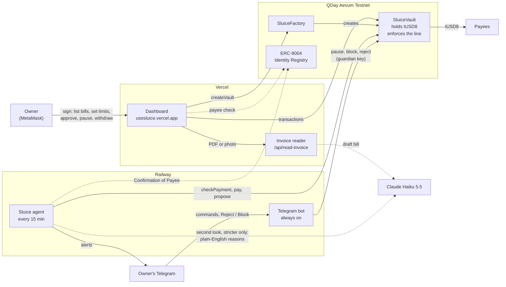
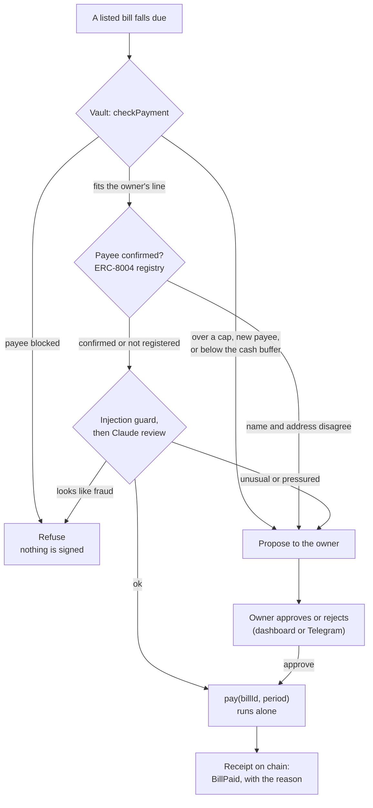
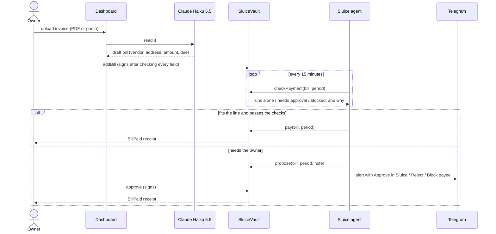

# Sluice

**An AI agent that pays your company's bills, but can't spend past the line you set.**

Small and mid-size companies have no treasury team. Bills are paid by hand, cash runs short without warning, and fake "we changed our bank details" invoices took about $3 billion from US businesses in 2025. An AI agent could do the work, but handing it a wallet key lets it spend everything, including on the next phishing invoice.

Sluice keeps the money in the company's own vault on **QDay Aevum** and lets the agent settle only the bills the owner listed: that payee, that amount, that schedule. Anything outside the owner's limits waits for the owner. The rules live in the contract, so they hold even if the agent's model is fooled or its key is stolen.

**Live:** https://usesluice.vercel.app · **Demo video:** https://youtu.be/RquoIjXKTAc · Telegram: [@Sluice1_bot](https://t.me/Sluice1_bot)

**Contents:** [Proven live](#proven-live-on-aevum-testnet) · [How it works](#how-it-works) · [Who it's for](#who-its-for) · [Guardrails](#guardrails-enforced-on-chain) · [Check it](#check-it) · [Run it yourself](#run-it-yourself) · [API reference](#api-reference) · [Known limits](#known-limits) · [**Roadmap**](#roadmap-to-mainnet) · [Team](#team)

Built for **Aevum Builder Challenge #1** · tracks: Native AI Assistants, Invoice Payments.

> All code in this repository was written during the build window (Nov 16 to Dec 11, 2026).

## Proven live on Aevum Testnet

Not just tests on a laptop: every function below was used for real on the live chain. Click any link to see the transaction.

| What we checked | Result | See it |
|---|---|---|
| The agent pays a listed bill on its own | Paid Northwind Hosting 1.00 tUSD8, inside every limit | [transaction](https://explorer-test.qday.info/tx/0x48003b9e0b7145f44e629a5f0a6a314c05b9287fa2db10ac5de8de10ec59841f) |
| A bill over the agent's cap goes to the owner | Agent proposed it; the owner approved; 0.8 tUSD8 reached that bill's payee | [proposal](https://explorer-test.qday.info/tx/0x05d0c3e1eff8350c9b6c06b921432aac3728bab1c8da5cb8a741b4d29b49d411) · [approval](https://explorer-test.qday.info/tx/0x341ae81cdc27c70bb787c492679c8f4738cfb84e34ba616afe913f060ebfe74e) |
| A "new bank details" scam invoice | Refused every round: the payee is blocked | [agent run log](https://github.com/Ultraviolet01/Sluice/actions/runs/45167004111) |
| The Telegram bot's key (guardian) | Could pause and block; could **not** unpause, approve or withdraw | [pause by the bot](https://explorer-test.qday.info/tx/0xf8c57ca6898bda9e5458d784302e305034fbee2f0f3f0c6a94c5e0860b2e415d) |
| Every contract function, owner, agent and bot | **59 of 59** behaved as designed | [full list](docs/VERIFIED.md#every-contract-function-used-live) |
| Deposit, agent payment, approval, withdrawal | **10 of 10**, checked against real token balances | [details](docs/VERIFIED.md#money-moving-live) |
| A stolen agent key | **28 of 28** attacks refused | [details](docs/VERIFIED.md#a-stolen-agent-key-against-the-live-vault) |
| 101 junk proposals from the agent's key | Only 2 accepted (one per bill due); the owner could still act | [details](docs/VERIFIED.md#proposal-flood) |

All three contracts' source code is verified on the explorer: [IdentityRegistry (ERC-8004)](https://explorer-test.qday.info/address/0x6835B4258025A5c1723Cd236cBa5a37FFa789b2D), [SluiceFactory](https://explorer-test.qday.info/address/0x3aa047ecdE17F1ed439d3bED372A1e36EFD462F9), [SluiceVault](https://explorer-test.qday.info/address/0x15deBE3Bed0A0Bf705B6800d279f038097dc1706).

## How it works



1. **The owner lists bills and sets the line**: per-payment cap, rolling 24-hour budget, cash buffer, approval threshold, approved and blocked payees, and a session for the agent with an expiry.
2. **The agent runs every 15 minutes.** It forecasts the next 14 days, asks the vault about each bill that's due, and pays what fits. A bill that's over the line, to a new payee, or more than 25% above that payee's usual amount goes to the owner as a proposal. Before paying anything alone, an injection guard and then Claude Haiku 5.5 take a second look, and can only make the decision stricter.
3. **The owner signs the big ones** in the dashboard, with the reasons and policy checks laid out, and gets a Telegram message when something needs them. Every payment and rule change is a receipt on chain.

**How the agent decides one bill.** The vault has the last word on every step: even if the agent skipped one, the contract would refuse.



**One invoice, start to finish.**



A bill that would break the cash buffer but isn't due yet is held until it is: money may come in first. Bills marked **critical** (payroll, rent) are paid first and never held. Each proposal's reason is written in plain English by Claude Haiku 5.5 from the agent's own facts.

Anyone can **create their company's vault** from the dashboard in one signature (`SluiceFactory`), **import** up to 50 bills at once from a CSV or from several invoices (Claude Haiku 5.5 reads a PDF or photo into a draft bill the owner checks and signs), approve many payees in one signature, and **deposit** from the dashboard. A **Get started** checklist walks a new company through funding, payees, bills and hiring the agent. **Your companies** lists every company the wallet owns, including ones handed to it.

**Telegram ([@Sluice1_bot](https://t.me/Sluice1_bot)).** The owner links a chat from Settings with one signature, and the agent's alerts for that company go only there: a bill waiting for approval (with Reject and Block payee buttons), a refused payment, a shortfall ahead, the agent's session about to end. `/balance`, `/bills` and `/pending` answer in the chat. If the owner turns on Telegram actions, the bot can also pause the vault, block a payee or reject a proposal: it is the vault's *guardian*, a key that can only make the vault stricter.

**Reports.** *Export to Excel* on the Activity page downloads a treasury report for any period: Summary, Activity, Payments, Ledger (every tUSD8 in and out, named from the vault's own records), Rule changes (each with the owner's reason as written on chain) and Wallets, with explorer links.

## Who it's for

Small and mid-size companies with recurring bills and no treasury team: agencies, studios, small importers, DAOs and crypto-native startups that already hold stablecoins. Today a founder either pays every invoice by hand or hands a bookkeeper (or a script) the keys. Sluice gives them the automation without the key risk: bills paid on time, a shortfall seen 14 days ahead, and fake "new bank details" invoices refused by the contract itself.

### The losses are real

Paying the wrong address is the most expensive routine mistake a finance team can make, and the numbers are public:

| What | Figure | Source |
|---|---|---|
| Losses to business email compromise (fake "we've changed our bank details" invoices and spoofed payees), US complaints to the FBI | **$2.77 billion in 2024**, **$2.95 billion in 2023**, **$2.74 billion in 2022**, about 21,000 complaints a year | FBI Internet Crime Complaint Center, [2024 report](https://www.ic3.gov/AnnualReport/Reports/2024_IC3Report.pdf) and [2023 report](https://www.ic3.gov/AnnualReport/Reports/2023_IC3Report.pdf) |
| All losses reported to the FBI in 2024 | **$16.6 billion**, up 33% on 2023 | FBI IC3, 2024 report |
| Companies hit by payments fraud | **79%** were victims of attempted or actual payments fraud in 2024; business email compromise was the most common route (**63%**) | Association for Financial Professionals, [2025 survey](https://www.financialprofessionals.org/about/learn-more/press-releases/Details/survey-79-percent-of-organizations-were-victims-of-attempted-or-actual-payments-fraud-activity-in-2024/) |
| The same survey a year later | **76%** of US organisations met attempted or actual payments fraud in 2025, and **74%** were affected by business email compromise | AFP, [2026 survey](https://www.financialprofessionals.org/about/learn-more/press-releases/Details/over-75-percent-of-us-firms-experienced-payments-fraud-in-2025-while-ai-adoption-for-fraud-mitigation-lags/) |
| Crypto stolen in 2024 | **$2.2 billion**, and **43.8%** of it through compromised private keys, the largest single cause | Chainalysis, [2024 hacking report](https://www.chainalysis.com/blog/crypto-hacking-stolen-funds-2025/) |

These are the two ways a company loses treasury money: it pays an address an attacker supplied, or a key that can move the money is stolen. Sluice answers both. The agent can only pay bills the owner listed, and the payee is checked against its registered identity first. A stolen agent key can still only pay those same listed bills, inside its caps.

How it reaches them: a free tier for one company and a few bills, then a monthly fee per company for the hosted agent and Telegram alerts. The vault stays the owner's, so they can leave at any time and keep their money and history. The first users are teams already paying contractors and software in stablecoins, reached through the wallets and accounting tools they use.

## Where it runs

| Part | Where | What it does |
|---|---|---|
| Contracts | QDay Aevum Testnet | `SluiceFactory` creates each company's `SluiceVault`; the vault holds the tUSD8 and enforces every rule |
| Dashboard and invoice reader | Vercel: https://usesluice.vercel.app | The owner's app; the invoice reader is a serverless function calling Claude Haiku 5.5 |
| Agent | Railway, a scheduled job every 15 minutes | One round over every company that gave it a session; GitHub Actions can run a round by hand as a backup |
| Telegram bot | Railway, always on | Sends nothing on its own: answers commands and acts as guardian when the owner allowed it |

## Guardrails (enforced on-chain)

| Control | How |
|---|---|
| Bills only | `pay(billId, period)` takes no payee and no amount, so even a stolen agent key can only pay the owner's own bills |
| Once per period | Each bill period settles at most once, and never more than 3 days early |
| Scoped session | The agent gets a per-payment cap, a rolling 24h cap and an expiry (`grantSession`) |
| Instant stop | `revokeSession(agent)`; `pause()` halts every agent payment; granting a new agent revokes the old key |
| Guardian | Optional second key (the Telegram bot) that can only make a vault stricter: pause, block a payee, reject a proposal. Never unpause, unblock, approve, change a limit or move money |
| Ownership | Two-step hand-over to a new wallet or a Safe: the owner offers, the new owner accepts, and the owner can cancel before then |
| Payees | New payees need the owner; the blocklist always wins, even on owner approval |
| Confirmation of Payee | Before paying alone, the agent checks the bill's payee against the ERC-8004 Identity Registry. A bill naming a registered business at a different address goes to the owner instead. A registered address under another name is only a note when the owner has already approved that payee (a contractor's wallet on a "Payroll" bill), and a warning otherwise. The bill form and Approvals show the result. Enforced by the agent, not the vault |
| Human approval | Bills outside the limits are proposed with a note and wait for `approve` or `reject` |
| Cash buffer | No agent payment may drop the vault below `cashBuffer` |
| Ask first | `checkPayment(agent, billId, period)` says whether a payment runs alone, needs approval or is blocked, and why |
| Receipts and reasons | `BillPaid`, `PaymentProposed`, `PaymentRejected`; every rule change (`PolicyChanged`, payees, sessions, cancelled bills) is logged with the owner's reason |

27 attacks with a stolen key (agent or bot), all refused: [`contracts/test/attacks.test.js`](contracts/test/attacks.test.js). Every claim with its line of code: [docs/SECURITY.md](docs/SECURITY.md).

## Check it

You need Node.js 22.

```bash
npm run verify
```

Ends `VERIFY PASSED: contracts, agent, bot and web`: 64 contract tests (vault, factory, ERC-8004 registry, the attack suite and randomised runs), the agent's typecheck and 53 tests (including 2,000-case randomised checks), the bot's tests, the web tests, and the web build.

### See the agent work, locally

```bash
cd contracts && npm install --legacy-peer-deps && npx hardhat node
```

In a second terminal:

```bash
cd contracts && npx hardhat run scripts/local-demo.js --network localhost
```

```bash
cd agent && npm install && SLUICE_LOCAL=1 AEVUM_RPC_URL=http://127.0.0.1:8545 SLUICE_VAULTS=<vault printed above> AGENT_PRIVATE_KEY=<Hardhat account #1 key> npm run agent
```

You see Northwind paid alone, Atlas proposed (over the cap), Figma proposed (new payee), the "new bank details" bill refused (blocklisted), and December left for later. Run it again: nothing new happens, because the vault remembers.

### On Aevum Testnet

After deploying: `npm run demo:setup`, `npm run functions`, `npm run money`, `npm run attacks` and `npm run flood` in `contracts/` (each with `-- --network aevumTestnet`) set up the demo company and run the stolen-key checks against it; `npm run agent:new-key`, `agent:fund` and `agent:rotate` create, fund and rotate the agent's key; `npm run demo` in `agent/` tells one round step by step; `node scripts/verified.mjs` in `contracts/` writes [docs/VERIFIED.md](docs/VERIFIED.md) from their records.

### The dashboard

```bash
cd web && npm install && npm run dev
```

Demo data by default; add `?vault=0x…` to the address (`#/app/overview?vault=0x…`) to read a live vault on Aevum. See [web/README.md](web/README.md).

## Network

| | |
|---|---|
| Chain | QDay Aevum Testnet, chain ID `44005` |
| RPC | `https://rpc-test.qday.info` |
| Explorer | https://explorer-test.qday.info/ |
| tUSD8 | `0x456569838f1d43009A91ebA4263147Afd7233483` (6 decimals: `1 tUSD8 = 1_000_000`) |
| Faucet | https://faucet.qday.info/en |
| Factory | [`0x3aa047ecdE17F1ed439d3bED372A1e36EFD462F9`](https://explorer-test.qday.info/address/0x3aa047ecdE17F1ed439d3bED372A1e36EFD462F9) |
| Vault (deployed directly) | [`0x15deBE3Bed0A0Bf705B6800d279f038097dc1706`](https://explorer-test.qday.info/address/0x15deBE3Bed0A0Bf705B6800d279f038097dc1706) |
| Function-check company (every function, live) | [`0x9CbF6aF73967CB87014d75dC774aEDf20F9648D3`](https://explorer-test.qday.info/address/0x9CbF6aF73967CB87014d75dC774aEDf20F9648D3) |
| ERC-8004 Identity Registry | [`0x6835B4258025A5c1723Cd236cBa5a37FFa789b2D`](https://explorer-test.qday.info/address/0x6835B4258025A5c1723Cd236cBa5a37FFa789b2D) (Aevum has no canonical deployment, so Sluice deployed one to the spec) |
| Agent | `0x2ea4bf1d859918adf150F032F7E0C233f5498d3A` |
| Telegram bot (guardian) | `0xc0940c4BAd322FBB09CB27ca0442e96f11C3AC29` |
| Deployed at block | `3911562` |
| Source | Verified on the explorer (`node scripts/verify-explorer.mjs` in `contracts/`) |

Deploy (needs tQDAY for gas):

```bash
cd contracts && cp .env.example .env
```

Fill in `DEPLOYER_PRIVATE_KEY` and `OWNER_ADDRESS` (`.env` is gitignored), then:

```bash
npm run deploy
```

## Platform integrations

| Platform | How Sluice uses it |
|---|---|
| **QDay Aevum Testnet** (chain 44005) | Both contracts are deployed and source-verified there; every payment, proposal, rule change and receipt is an Aevum transaction or event |
| **tUSD8** | The only money the vault holds and pays out (6 decimals); deposits are plain ERC-20 transfers to the vault |
| **QDay explorer** | Every receipt in the dashboard, the Telegram alerts, the Excel report and [docs/VERIFIED.md](docs/VERIFIED.md) links to it |
| **Claude Haiku 5.5** (Anthropic) | Three jobs, never the final say: a second look at each payment the agent would make alone (can only make it stricter), the plain-English reason on each proposal, and reading invoices into draft bills |
| **Telegram** | Alerts to the chat each owner links on chain; commands and guardian actions through [@Sluice1_bot](https://t.me/Sluice1_bot) |
| **MetaMask** (any EIP-1193 wallet) | The owner signs every rule change, approval and withdrawal; the site adds Aevum to the wallet if needed |
| **Vercel** | Hosts the dashboard and the invoice reader function |
| **Railway** | Runs the agent every 15 minutes and the Telegram bot around the clock |
| **GitHub Actions** | Runs every test on each push, and one agent round by hand when wanted |

## Run it yourself

Everything runs on a laptop against a local chain first (see [Check it](#check-it)). To run your own copy on Aevum Testnet:

1. **Wallet**: add Aevum Testnet (chain 44005, RPC `https://rpc-test.qday.info`) and get tQDAY and tUSD8 from the [faucet](https://faucet.qday.info/en).
2. **Contracts**: `cd contracts && cp .env.example .env`, fill in `DEPLOYER_PRIVATE_KEY` and `OWNER_ADDRESS`, then `npm run deploy`. Verify the source with `node scripts/verify-explorer.mjs`.
3. **Agent key**: `npm run agent:new-key` (writes `contracts/agent.key`, git-ignored), then `npm run agent:fund -- --network aevumTestnet`.
4. **Dashboard**: in `web/`, set `VITE_FACTORY_ADDRESS`, `VITE_AGENT_ADDRESS`, `VITE_FROM_BLOCK` (and `ANTHROPIC_API_KEY` for the invoice reader), then `npm run build`. Any static host works; Vercel also runs `api/read-invoice.ts`. All settings: [web/README.md](web/README.md).
5. **Agent**: run `npm run agent` in `agent/` on a schedule with `AGENT_PRIVATE_KEY`, `SLUICE_FACTORY`, `SLUICE_FROM_BLOCK`, and optionally `ANTHROPIC_API_KEY`, `TELEGRAM_BOT_TOKEN`, `SLUICE_APP_URL`, `SLUICE_ALERT_STATE`. Railway: root directory `agent`, build `npm run build`, start `node --max-old-space-size=192 dist/main.mjs`, cron `*/15 * * * *`. All settings: [agent/README.md](agent/README.md).
6. **Telegram bot** (optional): `npm run build && npm start` in `bot/` with `TELEGRAM_BOT_TOKEN`, `BOT_GUARDIAN_KEY`, `SLUICE_FACTORY`, `SLUICE_APP_URL`. Steps: [bot/README.md](bot/README.md).

## API reference

### SluiceVault (one per company)

| Who | Function | What it does |
|---|---|---|
| Owner | `addBill(payee, amount, firstDue, intervalDays, critical, label)`, `addBills(bills[])` | List bills (up to 50 at once). The agent can only ever pay these |
| Owner | `cancelBill(billId, reason)`, `releaseBill(billId, period)` | Stop a bill; reopen a rejected period |
| Owner | `setPayeeAllowed` / `setPayeesAllowed`, `setPayeeBlocked` / `setPayeesBlocked` | Approved and blocked payees, one or many, each with a reason |
| Owner | `setCashBuffer(amount, reason)`, `setApprovalThreshold(amount, reason)` | Money the agent must leave in the vault; size above which bills wait for the owner |
| Owner | `grantSession(agent, perPaymentCap, dailyCap, expiresAt, reason)`, `revokeSession(agent, reason)` | Hire, limit or fire the agent; granting a new agent revokes the old key |
| Owner | `approve(billId, period)` | Pay a proposed bill |
| Owner | `withdraw(to, amount)`, `unpause()` | Take money out (works even while paused); resume |
| Owner | `setGuardian(address, reason)`, `setNotifyChat(chat)` | Turn Telegram actions on or off; link the alert chat |
| Owner | `transferOwnership(to)` / new owner `acceptOwnership()` | Two-step hand-over |
| Owner or guardian | `pause()`, `reject(billId, period)`, `guardianBlock(payee, reason)` | Make the vault stricter |
| Agent | `pay(billId, period)` | Pay a listed bill inside every limit. Takes no payee and no amount |
| Agent | `propose(billId, period, note)` | Send a bill to the owner with a reason |
| Anyone | `checkPayment(agent, billId, period)` | `RunsAlone`, `NeedsApproval` or `Blocked`, and the reason code |
| Anyone | `getBill`, `billCount`, `dueAt`, `balance`, `spentInWindow`, `remainingDailyBudget`, `sessions`, `settlements` | Read the vault's state |

Events, all with the owner's reason where one applies: `BillAdded`, `BillCancelled`, `BillReleased`, `BillPaid` (says whether the owner approved it), `PaymentProposed`, `PaymentRejected`, `PolicyChanged` (old and new value), `PayeeAllowed`, `PayeeBlocked`, `SessionGranted`, `SessionRevoked`, `GuardianSet`, `NotifyChatSet`, `Withdrawn`, plus OpenZeppelin's `Paused`, `Unpaused` and ownership events.

### SluiceFactory

`createVault(name, cashBuffer, approvalThreshold)` creates a vault owned by the caller (at most 20 per creator). Reads: `vaultCount()`, `vaultAt(i)`, `vaultsCreatedBy(creator)`, `nameOf(vault)`, `isVault(address)`. Event: `VaultCreated(creator, vault, name)`.

### Invoice reader (HTTP)

`POST /api/read-invoice` with JSON `{ "media_type": "application/pdf" | "image/png" | "image/jpeg" | "image/webp", "data": "<base64, under 4.5 MB>" }` returns `{ "draft": { "vendor", "address", "amount", "due", "summary" } }`, or `{ "error" }`. Same-site only, rate-limited, stores nothing. The owner still checks and signs the bill.

### Telegram bot

`/balance`, `/bills`, `/pending`, `/pause`, `/block 0x… reason`, `/vaults`, `/help`. Buttons on alerts: Reject, Block payee, Approve in Sluice (opens the dashboard). Details: [bot/README.md](bot/README.md).

## Assumptions

- The owner's wallet is safe. The owner can do anything to their own vault; Sluice protects the company from the agent and from fake invoices, not from its own owner.
- Payee addresses listed by the owner are correct. Sluice pays only listed bills to their listed payees, so the risk moves to the moment a bill is listed, where the owner signs it.
- Bills are in tUSD8 on Aevum. Other tokens and other chains are on the roadmap.
- A round every 15 minutes is fast enough for bills, and a missed round is harmless: the vault remembers what was settled, so the next round picks up where the last stopped.
- Claude may be wrong or unavailable. It can only make a decision stricter, and without it the agent follows its rules.

## Repository

| Folder | What |
|---|---|
| `contracts/` | `SluiceVault.sol`, `SluiceFactory.sol`, tests and attack suite, deploy and local demo scripts (Hardhat) |
| `bot/` | The Telegram bot (Railway): alerts to each founder, `/balance`, `/pending`, and pause / block / reject as the vault's guardian. See [bot/README.md](bot/README.md) |
| `agent/` | The agent: observe, forecast, decide, review, act, learn. See [agent/README.md](agent/README.md) |
| `web/` | Landing page, owner dashboard, and the invoice reader function. See [web/README.md](web/README.md) |
| `docs/` | [Proof on Aevum](docs/VERIFIED.md), [security](docs/SECURITY.md), [judging criteria map](docs/JUDGING.md), [backlog](docs/BACKLOG.md) |
| `.github/workflows/` | `ci.yml` runs every check on each push; `agent.yml` runs one agent round by hand (the 15-minute schedule runs on Railway) |

## Known limits

- The Claude review fails open: if the model is unreachable, the agent follows its rules, and the vault's limits still apply.
- The dashboard manages one agent session per vault (the latest granted).
- At most 32 agent payments per vault in 24 hours; beyond that, payments wait for the next window or the owner.
- Testnet tokens have no value. Nothing here has moved real money.

## Roadmap to mainnet

1. **Per-payee caps** on chain.

Done since the first draft: **Confirmation of Payee** through ERC-8004 (see Guardrails).
2. **Multisig owner** (a Safe), so approvals take more than one signature.
3. **Gas paid in tUSD8** through an ERC-4337 paymaster, if Aevum runs a bundler.
4. **Paying a payee on another chain** through the QDay Bridge, once its contracts and tokens are published (today it links only QDay Origin testnet and Aevum testnet). The vault's limits and the owner's approval still apply before anything leaves Aevum.
5. **Earning on idle cash** through QDay's lending protocol (QLEAP) once it is live on Aevum: only money above the buffer and the next 14 days of bills, up to an owner-set cap.
6. **An audit** before any mainnet money.

Details: [docs/JUDGING.md](docs/JUDGING.md#roadmap-to-mainnet).

## Dependencies

- OpenZeppelin Contracts 5.1, Hardhat, ethers v6, chai (MIT) for the contract
- viem, @anthropic-ai/sdk, tsx (MIT) for the agent
- tsx, viem (MIT) for the Telegram bot
- React 18, Vite 5, viem, ExcelJS, three.js (MIT) for the dashboard; Fraunces, Hanken Grotesk and Geist Mono from Google Fonts (OFL)

## Demo video

[](https://youtu.be/RquoIjXKTAc)

**https://youtu.be/RquoIjXKTAc** (2:58). Real screen recordings of Sluice working on Aevum Testnet: a company created, an invoice read by Claude, payees approved and blocked, the agent's real round (including Claude catching a lookalike vendor), approvals and a rejection signed on chain, the Telegram bot, the Excel report, and every transaction opened on the explorer.

## Team

- **ultraviolet01** ([GitHub](https://github.com/Ultraviolet01)): design, contracts, agent, dashboard and bot. Solo entry.

## License

MIT, see [LICENSE](LICENSE).
